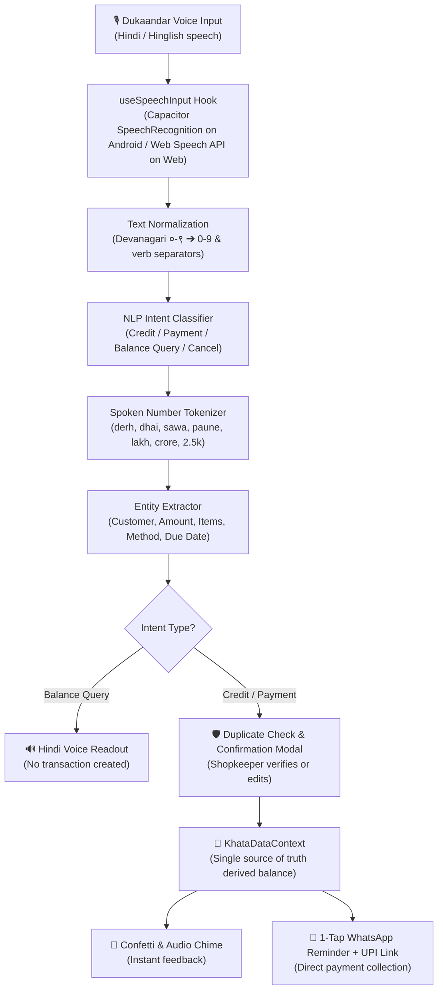

# 🎙️ BolKhata (बोलखाता)
### Voice-First Digital Khata Ledger for Indian Kirana Shopkeepers & Small Merchants

[](https://react.dev/)
[](https://vitejs.dev/)
[](https://vitest.dev/)
[](https://tailwindcss.com/)
[](https://capacitorjs.com/)
[](https://www.docker.com/)

> **"बोलिए और खाता लिखिए"** — BolKhata turns spoken Hindi, Hinglish, and English Kirana commands into clean financial ledger records in real-time. Zero typing required.

---

## 📌 Problem Statement

Over 13 million local Kirana stores drive 88% of India's retail grocery market. Yet:
* **Small Touchscreen Keyboard Fatigue:** Dukaandars handle busy customer counters; typing customer names, items, and numbers on mobile keyboards while packing ration is slow and prone to errors.
* **Paper Diary (लाल बही-खाता) Inefficiencies:** Paper diaries easily tear, get misplaced, don't calculate running balances automatically, and cannot send instant payment reminders with UPI links.
* **Internet Dependency & Cloud LLM Costs:** Paid LLM APIs (OpenAI, Gemini) cost money per token, take 2–5 seconds of round-trip latency, and stop working if network connectivity fluctuates in rural or mandi markets.

---

## 💡 The BolKhata Solution

BolKhata is a **responsive, voice-first web & mobile ledger (PWA & Android via Capacitor)**:
1. **Speak Naturally in Hindi / Hinglish:** Dukaandar speaks: *"Ramesh bhai ko 2500 rupaye ka udhaar diya"* or *"Suresh ne 1200 UPI jama kar diye"*.
2. **Proprietary Client-Side Voice Engine:** Instantly parses Devanagari numerals, spoken Hindi fractions (*डेढ़ हज़ार* = 1500, *ढाई सौ* = 250, *साढ़े चार सौ* = 450, *सवा सौ* = 125, *पौने दो सौ* = 175), grocery items, payment methods, and relative dates (*कल*, *अगले सोमवार*, *15 तारीख को*).
3. **Single Source of Truth for Balance:** Customer balances are derived dynamically from transaction history. Opening balances are recorded as credit transactions. Soft-delete and edit history maintain an immutable audit trail.
4. **Human-in-the-Loop Confirmation:** A visual modal opens with parsed details and duplicate detection guard (warns if a similar entry was recorded in the last 30 minutes).
5. **Instant Ledger Update & Audio Chime:** Procedural Web Audio API chime plays (PhonePe/Khatabook style) and updates the ledger running balance.
6. **1-Tap WhatsApp Payment Reminder:** Generates formatted Hinglish reminder messages embedded with deep-linked UPI URLs (`upi://pay?pa=...`) using verified NPCI format.

---

## 🏗️ Architecture & Data Correctness



### Key Technical Pillars:
* **Single Source of Truth (`KhataDataContext.jsx`):** Balances are derived dynamically using `useMemo` from transactions. No desync between customer balance and transaction ledger.
* **Atomic Storage & Rolling Backups (`storage.js`, `backupService.js`):** Unified storage key with rolling 7-day automatic snapshots and `navigator.storage.persist()`.
* **Zero Fake Names:** Spoken names are resolved against registered customers with phonetic fuzzy matching, or kept as raw spoken names for user confirmation.
* **Timezone Safety (`dateUtils.js`):** Date bucketing uses local YYYY-MM-DD keys (`toLocalDateKey`), resolving the IST 5:30 AM timezone discrepancy.
* **Audit Trail & Undo (`CustomerLedgerModal.jsx`):** Transaction edits preserve history snapshots; soft-deletes are restorable with a 7-second Undo toast.
* **Security & Privacy:** Client-side 4-digit PIN lock with salted SHA-256 Web Crypto. All financial data, ledgers, and rolling backups run 100% locally on the device without network dependencies.

---

## 🚀 Quickstart Guide

### Option 1: Local Development Setup (Node.js)

**Prerequisites:** Node.js 18+ and npm.

1. Clone or navigate to the repository:
   ```bash
   git clone https://github.com/fazalmd755/BolKhata.git
   cd BolKhata
   ```

2. Install dependencies:
   ```bash
   npm install
   ```

3. Run unit test suite:
   ```bash
   npm test
   ```

4. Start development server:
   ```bash
   npm run dev
   ```

5. Open **http://localhost:5173** in Google Chrome or Microsoft Edge.

---

### Option 2: Production Build & Docker

1. Build production bundle:
   ```bash
   npm run build
   ```

2. Run with Docker Compose:
   ```bash
   docker compose up --build
   ```

---

### Option 3: Capacitor Android Build

1. Build the web distribution:
   ```bash
   npm run build
   ```

2. Sync assets with Capacitor:
   ```bash
   npx cap sync android
   ```

3. Open in Android Studio to build APK:
   ```bash
   npx cap open android
   ```

---

## 🧪 Verified Voice Commands (Test Dataset)

Click the **Demo Commands** chips inside the app or speak these into the microphone:

| Category | Spoken Command | Extracted Entities | Action |
| :--- | :--- | :--- | :--- |
| **Udhaar (Credit)** | *"Ramesh bhai ko 2500 rupaye ka udhaar diya"* | Customer: **Ramesh**<br>Amount: **₹2,500**<br>Type: **Credit** | Opens Confirm Modal with red credit badge |
| **Udhaar + Items + Date** | *"Suresh ko 450 rupaye ka tel aur cheeni udhaar di, agle somwar denge"* | Customer: **Suresh Sharma**<br>Amount: **₹450**<br>Items: **tel, cheeni**<br>Due Date: **Next Monday** | Formats items & sets due date automatically |
| **Payment (UPI)** | *"Suresh ne 1200 rupaye UPI kar diye"* | Customer: **Suresh Sharma**<br>Amount: **₹1,200**<br>Method: **UPI**<br>Type: **Payment** | Deducts balance; opens confirm modal |
| **Payment (Cash)** | *"Mohan Lal ne paanch sau rupaye cash jama kiye"* | Customer: **Mohan Lal**<br>Amount: **₹500**<br>Method: **Cash** | Records cash collection |
| **Colloquial Fractions** | *"Vikram ko dedh hazar udhar diya"* | Customer: **Vikram**<br>Amount: **₹1,500**<br>Type: **Credit** | Evaluates डेढ़ हज़ार as 1500 |
| **Balance Query (हिसाब)** | *"Mohan Lal ka kitna udhaar baaki hai?"* | Customer: **Mohan Lal**<br>Intent: **Balance Query** | **Speaks balance aloud in Hindi** (Zero transaction saved) |
| **Negative Intent** | *"Ramesh ne paise nahi diye"* | Customer: **Ramesh**<br>Intent: **Unpaid Warning** | Flags warning without marking payment |
| **New Customer** | *"नया ग्राहक रमेश भाई 2500 उधार"* | Customer: **Ramesh**<br>Amount: **₹2,500** | **Creates new customer ledger** |

---

## 🛠️ Project Structure

```
BolKhata/
├── .github/workflows/ci.yml # GitHub Actions CI workflow (lint, test, build)
├── android/                # Native Capacitor 8 Android project
├── nginx.conf              # Production Nginx config with security headers (CSP, X-Frame-Options)
├── package.json            # Scripts & frontend dependencies
├── tests/                  # Vitest comprehensive unit test suite (86+ tests)
│   ├── balance.test.js     # Single source of truth & soft-delete recalculations
│   ├── backupValidation.test.js # Strict backup schema & sanitizer tests
│   ├── dateUtils.test.js   # Timezone IST fix & relative date tests
│   ├── hindiNumberParser.test.js # Devanagari numerals & fraction compounds
│   ├── money.test.js       # Integer rupees, validation & UPI formats
│   ├── voiceParser.test.js # 44+ Hindi/Hinglish/English voice test matrix
│   └── i18n.test.js        # Dictionary string tests
├── src/
│   ├── context/
│   │   ├── KhataDataContext.jsx # Data store (customers, transactions, balance derivation, persistence)
│   │   ├── KhataUiContext.jsx   # UI store (activeModal, search, filters, undoAction)
│   │   └── KhataContext.jsx     # Backward-compatible facade provider & useKhata hook
│   ├── utils/
│   │   ├── money.js        # Single source of truth currency calculations
│   │   ├── storage.js      # Atomic storage, safety snapshot, migration
│   │   ├── backupService.js# Rolling 7-day backups, JSON/CSV exports
│   │   ├── pinAuth.js      # SHA-256 Web Crypto PIN authentication
│   │   ├── voiceParser.js  # NLP entity extractor & intent classifier
│   │   ├── hindiNumberParser.js # Devanagari numerals & Indian spoken number parser
│   │   ├── indianNameValidator.js # High-level regional name extraction & deduplication
│   │   ├── dateUtils.js    # Local-date bucketing (no IST 5:30 AM bug)
│   │   ├── whatsapp.js     # WhatsApp reminder templates & UPI deep links
│   │   └── soundEffects.js # Procedural Web Audio API synthesizer
│   ├── i18n/
│   │   └── index.js        # Lightweight Hindi & English translation dictionary
│   └── components/
│       ├── HomeTab.jsx     # Net credit hero card & quick actions
│       ├── VoiceBottomSheet.jsx # Voice recording overlay with fallback input
│       ├── TransactionConfirmModal.jsx # Pre-save verification & duplicate warning
│       ├── CustomerLedgerModal.jsx # Customer account with running balance, edit & delete
│       ├── OnboardingModal.jsx # First-run shop setup modal
│       ├── PinLockModal.jsx # 4-digit PIN lock screen
│       ├── UndoToast.jsx   # 7-second undo toast
│       └── SettingsView.jsx # Shop profile, backup indicators & demo data reset
```
